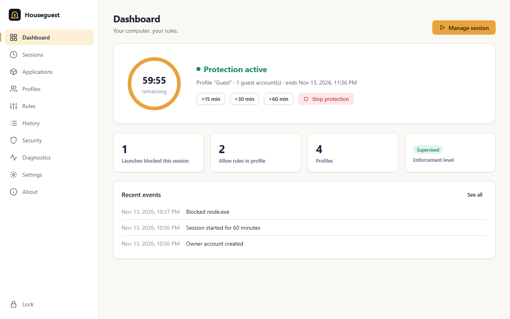
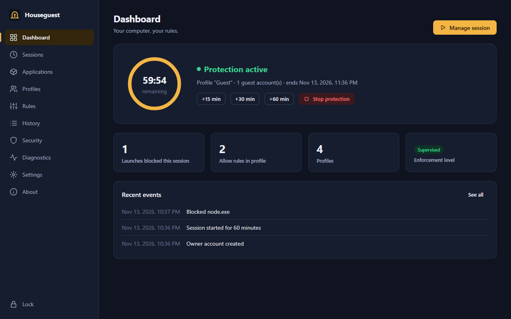
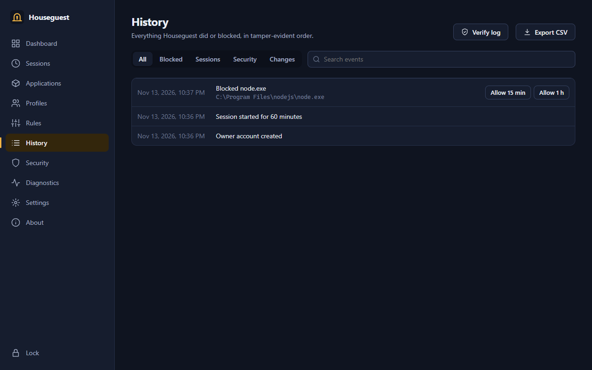

<p align="center">
  
</p>

<p align="center">
  <a href="https://github.com/UnkoynX777/houseguest/actions/workflows/ci.yml"></a>
  <a href="LICENSE"></a>
  <a href="docs/pt-BR/README.md">Português</a>
</p>

Houseguest lets you hand your Windows computer to someone else and decide exactly which programs they can run. Pick a profile, choose the guest account and a duration, and start protection. When the time is up, the restrictions lift and the guest is locked out.

Protection is enforced by a Windows service, so closing the window changes nothing. Everything is auditable: the source is public, every block and every change is written to a tamper-evident log, and the limits of what Windows can guarantee are documented below rather than hidden.

<p align="center">
  
  
</p>

## What it does

- **Guest sessions with a timer.** Choose a profile, one or more guest accounts and a duration. Extend, stop, or let it expire and lock the guest out.
- **Rules by path, hash or publisher.** Hash and publisher rules survive renaming. The editor explains which to use.
- **Ready-made profiles.** Guest, Gaming, Work and Restricted, all editable, duplicable, importable and exportable.
- **Preview before you commit.** See which of your installed apps would run and which would be blocked, with conflicts and risky rules flagged.
- **Audit mode.** Record what would be blocked without stopping anything.
- **Temporary exceptions.** Allow a blocked app for 15 minutes or an hour straight from the history.
- **Cannot lock you out.** Essential Windows processes and Houseguest itself are always allowed, and an administrator can always recover.
- **Private by design.** Nothing leaves your computer. Update checks contact GitHub only when you press the button.
- English and Portuguese, light and dark.

<p align="center">
  
  
</p>

## How protection works, and where it stops

Houseguest watches process creation through Event Tracing for Windows. When a program starts under a guest account, the service evaluates your rules and terminates the process if it is not allowed. This works on every Windows edition.

It is **reactive, not preventive**: a blocked program can run for a moment before it is stopped. Rules that match by path decide almost instantly; when the verdict depends on a digital signature or hash, the first launch of a large program can run for a few seconds while that is checked (results are cached afterwards). Houseguest never claims more than that.

| Who | What Houseguest guarantees |
| --- | --- |
| Standard user, with the window closed | Rules keep applying. The service, its data and its settings cannot be stopped, read or edited without administrator rights. Renaming an executable does not bypass hash or publisher rules. PIN guessing is rate limited. |
| Guest during a session | The session ends on time and the restrictions are lifted by the service. Allowed programs cannot change policy. |
| Local administrator | Tampering is detectable. Removal and recovery are always possible, by design. |
| Physical access | Nothing. Use BitLocker and a firmware password. |

Also worth knowing: programs you allow can start other programs, so review launchers and browsers; Microsoft Store apps are matched by executable path or publisher; AppLocker and App Control are not used yet. See [docs/threat-model.md](docs/threat-model.md) and [docs/feasibility.md](docs/feasibility.md) for the full picture.

## Install

Requires Windows 10 or 11 (x64) and the WebView2 runtime, which ships with Windows 11 and current Windows 10. **Verified so far only on Windows 10 Pro 22H2**; Windows 11 and other editions have not been tested yet.

1. Download `Houseguest-<version>-x64.msi` and `SHA256SUMS.txt` from the [latest release](https://github.com/UnkoynX777/houseguest/releases/latest).
2. Verify it: `(Get-FileHash .\Houseguest-*.msi).Hash` must match the line in `SHA256SUMS.txt`. Release builds also carry a provenance attestation: `gh attestation verify <file> --repo UnkoynX777/houseguest`.
3. Run the installer as administrator. It installs the `Houseguest` service and a Start Menu shortcut.

Builds are currently **unsigned**, so SmartScreen may warn you.

## First steps

1. Open Houseguest and choose **Continue as administrator**, then set an owner PIN.
2. Create a standard Windows account for your guest if you do not have one.
3. **Sessions**: pick a profile and the guest account, choose a duration, press **Preview** to check the result, then **Start protection**.
4. Add apps your guest needs from **Applications**, or edit rules under **Rules**.

Recovering access: from an elevated prompt, `houseguest-cli recover` ends the session; add `--reset-owner` to remove the owner and PIN. To uninstall, remove Houseguest from Installed apps. Your settings and audit log stay in `%ProgramData%\Houseguest` until you delete that folder.

## Build from source

You need Visual Studio 2022 with the C++ workload, CMake 3.25+, Ninja, Node.js 22 and (for the installer) the .NET SDK.

```powershell
cd ui; npm ci; npm run build; cd ..
.\scripts\build.ps1 -Config Release -RunTests
.\scripts\package.ps1          # MSI, portable zip and checksums in dist\
```

Verification scripts, which need an elevated shell and create a temporary local account: `scripts\e2e.ps1` (enforcement), `scripts\install-test.ps1` (installer and permissions) and `scripts\capture-screenshots.ps1` (drives the real interface; needs a `-DHOUSEGUEST_DEVTOOLS=ON` build).

## Architecture

```
houseguest.exe (WebView2 + Vue 3, unelevated)  --\
houseguest-cli.exe                              --+-- authenticated named pipe --> houseguest-service.exe (LocalSystem)
                                                                                    policy engine, ETW supervisor,
                                                                                    signed store, audit chain
```

`core` holds the portable policy engine and has no Windows dependency; `system` wraps the Windows APIs; `service` composes them; `host` and `ui` are the interface. Details in [docs/architecture.md](docs/architecture.md).

## Roadmap

Realistic and in this order: App Control for Business and AppLocker backends where the edition supports them, packaged (Store) app rules, code-signed releases, a Windows 11 compatibility matrix and accessibility audit. See [docs/roadmap.md](docs/roadmap.md).

## Contributing

Pull requests are welcome and are reviewed by a human. Please read [CONTRIBUTING.md](CONTRIBUTING.md). Report vulnerabilities privately as described in [SECURITY.md](SECURITY.md).

## License

Apache-2.0. See [LICENSE](LICENSE) and [THIRD_PARTY_NOTICES.md](THIRD_PARTY_NOTICES.md). Parts of this project were written with the help of AI tools and reviewed by the maintainer.
