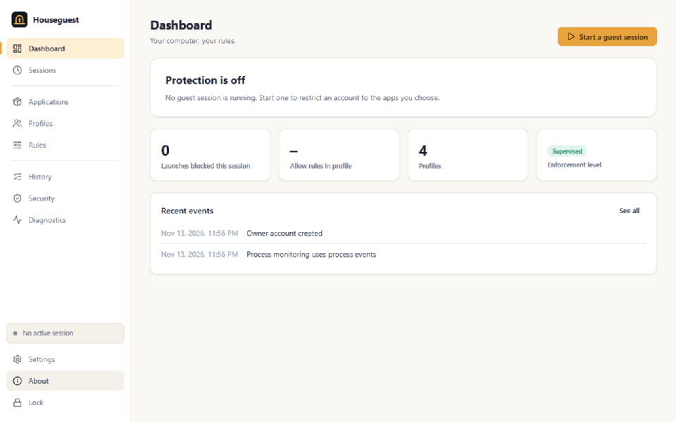
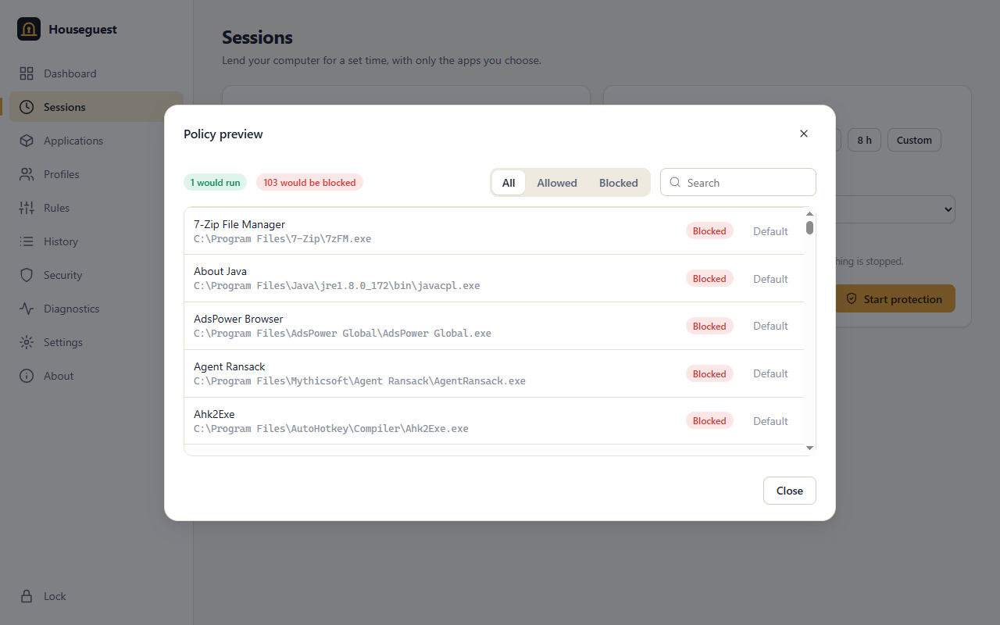

<p align="center">
  
</p>

<p align="center">
  <a href="https://github.com/UnkoynX777/houseguest/actions/workflows/ci.yml"></a>
  <a href="https://github.com/UnkoynX777/houseguest/releases/latest"></a>
  <a href="LICENSE"></a>
  <a href="docs/pt-BR/README.md">Português</a>
</p>

**Houseguest is an open-source Windows app blocker for guest sessions.** Hand your PC to a friend, a kid or a coworker and choose exactly which programs their account may run, for as long as you decide. When the time is up the restrictions lift and the guest is locked out.

A Windows service enforces the rules, so closing the window changes nothing. The source is public, every block and every change goes into a tamper-evident log, and the limits of what Windows can guarantee are written down instead of hidden.

<p align="center">
  
</p>

<p align="center">
  
  
</p>

## Why Houseguest

Windows has parental controls and policy features, but nothing simple for the common case: *"I am lending my PC for an hour. Let them use the browser and nothing else."* Houseguest is built for that case.

- **Guest sessions with a timer.** Choose a profile, the guest account and a duration. Extend, stop, or let it expire.
- **Application access control by path, hash or publisher.** Hash and publisher rules survive renaming. The editor explains which to use.
- **Ready-made profiles.** Guest, Gaming, Work and Restricted, all editable, importable and exportable.
- **Preview before you commit.** See which installed apps would run and which would be blocked, with conflicts flagged.
- **Audit mode.** Record what would be blocked without stopping anything.
- **Temporary exceptions** straight from the history.
- **Cannot lock you out.** Essential Windows processes and Houseguest itself are always allowed, and an administrator can always recover or uninstall.
- **Lives in the notification area**, starts with Windows if you want, follows the Windows light or dark theme, and shows the session timer.
- **Compact window.** One fixed 1000 × 700 (logical) size with a title bar drawn inside the page, a narrow icon rail and a denser layout. It shrinks to fit small screens and high display scaling instead of being cut off.
- **Remote access from your phone (optional, off by default).** A local API on a Windows-assigned loopback port, a Cloudflare Tunnel set up from the interface, Cloudflare Access sign-in verified again by Houseguest, per-phone keys and PIN confirmation for changes. See [remote access](docs/remote-access.md).
- **Assistant (optional, off by default).** Ask in plain words about apps, profiles and blocks with your own Gemini API key; it can propose profile changes that only happen after you confirm them. See [the assistant](docs/assistant.md).
- **Private by default.** With the optional features off, nothing leaves your computer. The update check contacts GitHub only when you press the button. Remote access and the assistant send data to Cloudflare and Google only after you configure them, and the documents above say exactly what.
- English and Portuguese.

<p align="center">
  
  
</p>

## Quick start

Requires Windows 10 or 11 (x64). The interface needs the Microsoft Edge WebView2 Runtime (included in Windows 11 and current Windows 10; Houseguest offers the official download if it is missing). **Verified so far only on Windows 10 Pro 22H2.** See [compatibility](docs/compatibility.md) for what was and was not tested. **Not yet verified against live services:** the Cloudflare setup and the Gemini assistant are tested with simulated responses and a real local API, but have not run with real credentials; the compact window and in-page title bar are built and unit-tested but were not observed in a real WebView2 window before this release.

1. Download `Houseguest-<version>-x64.msi` and `SHA256SUMS.txt` from the [latest release](https://github.com/UnkoynX777/houseguest/releases/latest).
2. Verify it: `sha256sum -c SHA256SUMS.txt`, or compare `(Get-FileHash .\Houseguest-*.msi).Hash` with the file. Releases also carry a provenance attestation: `gh attestation verify <file> --repo UnkoynX777/houseguest`.
3. Run the installer as administrator. It installs the `Houseguest` service and a Start Menu shortcut. Builds are **unsigned**, so SmartScreen may warn you.
4. Open Houseguest, set an owner PIN, create a standard Windows account for your guest, then **Sessions → Preview → Start protection**.

Recovery and removal always work for an administrator: `houseguest-cli recover` ends a session (`--reset-owner` also clears the PIN). While a session is active the uninstaller refuses to run unless you pass `FORCE_UNINSTALL=1`, so a guest session is never removed by accident. Details in [troubleshooting](docs/troubleshooting.md).

## How protection works, and where it stops

Houseguest watches process creation through Event Tracing for Windows. When a program starts under a guest account, the service evaluates your rules and terminates the process if it is not allowed. If Event Tracing is unavailable it falls back to checking running programs every second and tells you so.

It is **reactive, not preventive**: a blocked program can run for a moment before it is stopped. On the test machine the service stopped a denied program a few milliseconds after Windows reported its start (see [measurements](docs/performance.md)); that is the delay after the event, not a guarantee, and a very short-lived program can finish first. Houseguest does not use kernel drivers, AppLocker, App Control or Windows Defender, so it behaves the same on every edition.

| Who | What Houseguest guarantees |
| --- | --- |
| Standard user, window closed | Rules keep applying. The service, its data and its settings cannot be stopped, read or edited without administrator rights. Renaming an executable does not bypass hash or publisher rules. PIN guessing is rate limited. |
| Guest during a session | The session ends on time and the restrictions are lifted by the service. Allowed programs cannot change policy. |
| Local administrator | Tampering is detectable. Removal and recovery are always possible, by design. |
| Physical access | Nothing. Use BitLocker and a firmware password. |

Allowing a program does not allow everything it starts. A program is an application with explicit dependencies, each pinned by file hash or signer and valid only below that application (or, for components Windows starts on its behalf, only with a pin). You can find them by observing a run, and anything unknown is blocked and queued for your decision. Houseguest's own window, its WebView2 processes and a reviewed table of Windows components are never ended; see [architecture](docs/architecture.md). Limits worth knowing: a program that is not listed and not related is blocked even if an allowed program needs it, parent links can be spoofed by a process that may open its parent, and a very short-lived dependency can finish before it is evaluated. Read the [threat model](docs/threat-model.md) and the [FAQ](docs/faq.md).

## Documentation

[Remote access](docs/remote-access.md) · [Assistant](docs/assistant.md) · [FAQ](docs/faq.md) · [Compatibility](docs/compatibility.md) · [Troubleshooting](docs/troubleshooting.md) · [Use cases](docs/use-cases.md) · [Architecture](docs/architecture.md) · [Threat model](docs/threat-model.md) · [Privacy](docs/privacy.md) · [Performance](docs/performance.md) · [Roadmap](docs/roadmap.md) · [Website](https://unkoynx777.github.io/houseguest/)

## Build from source

Visual Studio 2022 with the C++ workload, CMake 3.25+, Ninja, Node.js 22 and, for the installer, the .NET SDK.

```powershell
cd ui; npm ci; npm run build; cd ..
.\scripts\build.ps1 -Config Release -RunTests
.\scripts\package.ps1          # MSI, portable zip, checksums in dist\
```

Checks that need an elevated shell and create a temporary local account: `scripts\e2e.ps1` (enforcement), `scripts\install-test.ps1` (installer, permissions, uninstall guard), `scripts\host-check.ps1` (window placement and tray), `scripts\capture-screenshots.ps1` (drives the real interface; needs `build.ps1 -Devtools`). Memory-safety: `build.ps1 -Sanitize -RunTests` for AddressSanitizer and `build.ps1 -Fuzz` plus `scripts\fuzz.ps1` for the libFuzzer targets.

## Contributing

Pull requests are welcome and are reviewed by a human. Please read [CONTRIBUTING.md](CONTRIBUTING.md). Report vulnerabilities privately as described in [SECURITY.md](SECURITY.md). Good first issues are labelled.

## License

Apache-2.0. See [LICENSE](LICENSE) and [THIRD_PARTY_NOTICES.md](THIRD_PARTY_NOTICES.md). Parts of this project were written with the help of AI tools and reviewed by the maintainer.
