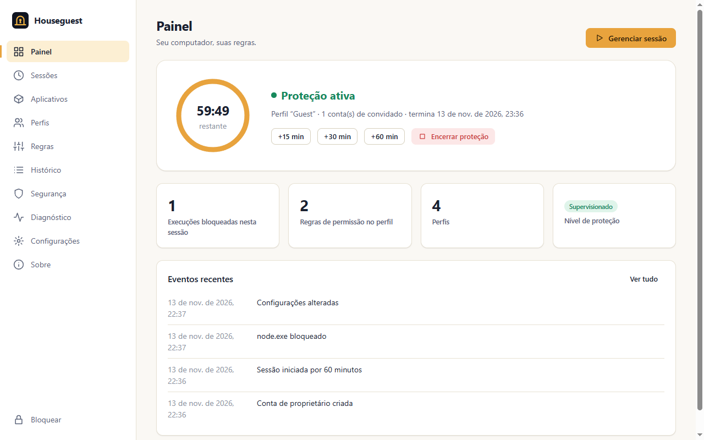

# Houseguest

**Empreste seu PC sem emprestar sua vida.**

O Houseguest permite entregar seu computador Windows a outra pessoa e decidir exatamente quais programas ela pode executar. Escolha um perfil, a conta do convidado e uma duração, e inicie a proteção. Quando o tempo acaba, as restrições são removidas e o convidado é bloqueado.

A proteção é aplicada por um serviço do Windows, então fechar a janela não muda nada. Tudo é auditável: o código é público, cada bloqueio e cada alteração vai para um registro à prova de adulteração, e os limites do que o Windows consegue garantir estão documentados em vez de escondidos.



## O que ele faz

- **Sessões de convidado com cronômetro**, com extensão, encerramento manual ou expiração com bloqueio do convidado.
- **Regras por caminho, hash ou fabricante.** Regras de hash e fabricante continuam valendo se o arquivo for renomeado.
- **Perfis prontos**: Visitante, Jogos, Trabalho e Restrito, todos editáveis, duplicáveis, importáveis e exportáveis.
- **Prévia antes de ativar**: veja quais apps instalados rodariam e quais seriam bloqueados, com conflitos e regras arriscadas sinalizados.
- **Modo de auditoria**: registra o que seria bloqueado sem encerrar nada.
- **Exceções temporárias** direto do histórico.
- **Sem risco de trancar você para fora**: processos essenciais do Windows e o próprio Houseguest são sempre permitidos, e um administrador sempre consegue recuperar o acesso.
- **Privado**: nada sai do seu computador. A verificação de atualizações só contata o GitHub quando você pede.

## Como a proteção funciona e onde ela termina

O Houseguest observa a criação de processos pelo Event Tracing for Windows. Quando um programa inicia sob uma conta de convidado, o serviço avalia suas regras e encerra o processo se ele não for permitido. Funciona em todas as edições do Windows.

A aplicação é **reativa, não preventiva**: um programa bloqueado pode executar por um instante antes de ser encerrado.

| Quem | O que o Houseguest garante |
| --- | --- |
| Usuário padrão, com a janela fechada | As regras continuam valendo. O serviço, seus dados e configurações não podem ser parados, lidos ou editados sem direitos de administrador. Renomear um executável não contorna regras de hash ou fabricante. As tentativas de PIN têm limite. |
| Convidado durante a sessão | A sessão termina no horário e o serviço remove as restrições. Programas permitidos não alteram a política. |
| Administrador local | Adulterações são detectáveis. Remoção e recuperação são sempre possíveis, de propósito. |
| Acesso físico | Nada. Use BitLocker e uma senha de firmware. |

Vale saber: programas permitidos podem iniciar outros programas; apps da Microsoft Store são identificados pelo caminho do executável ou pelo fabricante; AppLocker e App Control ainda não são usados. Veja o [modelo de ameaças](../threat-model.md) e a [viabilidade](../feasibility.md) (em inglês).

## Instalação

Requer Windows 10 ou 11 (x64) e o runtime do WebView2.

1. Baixe `Houseguest-<versão>-x64.msi` e `SHA256SUMS.txt` na [última release](https://github.com/UnkoynX777/houseguest/releases/latest).
2. Verifique: `(Get-FileHash .\Houseguest-*.msi).Hash` deve corresponder à linha de `SHA256SUMS.txt`.
3. Execute o instalador como administrador.

As versões ainda **não são assinadas digitalmente**, então o SmartScreen pode alertar. Validado apenas no Windows 10 Pro 22H2; Windows 11 e outras edições ainda não foram testados.

## Primeiros passos

1. Abra o Houseguest, escolha **Continuar como administrador** e defina um PIN de proprietário.
2. Crie uma conta padrão do Windows para o convidado.
3. Em **Sessões**: escolha o perfil e a conta, defina a duração, use **Prévia** e depois **Iniciar proteção**.
4. Adicione apps em **Aplicativos** ou edite as regras em **Regras**.

Recuperação: em um prompt elevado, `houseguest-cli recover` encerra a sessão; `--reset-owner` remove o proprietário e o PIN. Para desinstalar, remova o Houseguest em Aplicativos instalados. Configurações e registro de auditoria permanecem em `%ProgramData%\Houseguest` até você apagar a pasta.

## Compilar

Requer Visual Studio 2022 (carga de trabalho C++), CMake 3.25+, Ninja, Node.js 22 e o SDK do .NET para o instalador.

```powershell
cd ui; npm ci; npm run build; cd ..
.\scripts\build.ps1 -Config Release -RunTests
.\scripts\package.ps1
```

## Contribuir e segurança

Pull requests são bem-vindos e passam por revisão humana: veja o [CONTRIBUTING](../../CONTRIBUTING.md). Relate vulnerabilidades de forma privada, conforme o [SECURITY](../../SECURITY.md). Licença Apache-2.0. Partes do projeto foram escritas com ajuda de ferramentas de IA e revisadas pelo mantenedor.
